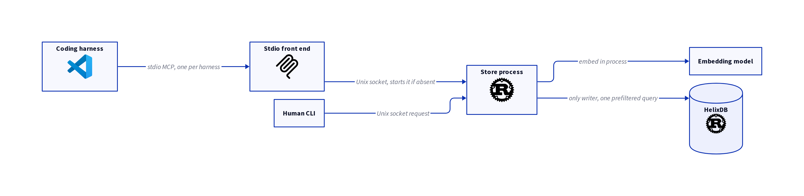
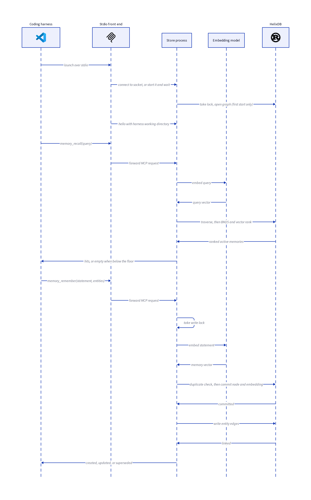

# Architecture

MCP Memory is a harness-agnostic memory service. Coding agents store and recall durable working context through MCP tools. The store is one knowledge graph. Product requirements, access rules, and acceptance tests are in [prd.md](prd.md).

## Components

- **Coding harness.** Cursor, Claude Code, Codex, Kiro, or any other MCP client. It launches `mcp-memory` and calls tools over stdio. Each result includes an action and titles.
- **Stdio front end.** The `mcp-memory` process each harness launches. It connects to the store process over a Unix socket and forwards MCP bytes both ways. It sends the harness's working directory first, so recall defaults to the repository the harness is in. When no store process is listening, it starts one.
- **Human CLI.** `mcp-memory list`, `search`, `delete`, `export`, and the rest. Each command is one request to the store process, run as the human actor. `config` edits `config.toml` directly.
- **Store process.** `mcp-memory daemon`, one per data directory. Helix fences an older writer when a newer one opens the same database, so this is the only process that opens the graph. It holds `run/daemon.lock` for its lifetime, listens on `run/mcp-memory.sock` inside a directory only the user can open, and refuses peers with another user id. It serves each harness connection as its own MCP session, enforces access mode and space scope, embeds text, and runs Helix queries. Writes go through one lock so duplicate detection sees earlier writes. It exits after five minutes with no connections (`MCP_MEMORY_IDLE_SECS`), and the next command starts it again. The server profile is not built yet: it would be stateless MCP replicas on a Helix cluster, and it would refuse to start without authentication.
- **Embedding model.** Runs inside the store process. The current model is `token-hash-v1`, 384 dimensions, a deterministic stand-in that shares the production dimension so a later semantic model is a reindex. Health reports this model id. Vectors are written onto memory nodes.
- **HelixDB.** The system of record, written in Rust, tag v3.7.0 with the embedded engine. One engine holds the property graph, BM25 full-text, and vector indexes. Local profile: embedded, data on disk. Server profile, when deployed: object storage, one writer, scaled readers.

```mermaid
flowchart LR
  harness[Coding harness] --> front[Stdio front end]
  front --> store[Store process]
  cli[Human CLI] --> store
  store --> model[Embedding model]
  store --> graph[HelixDB]
```



## Graph

Memories and entities are nodes. Recall walks edges instead of joining a second database.

- `Memory` holds the statement, the content hash, the embedding, and `status` (`active`, `superseded`, or `conflicted`). Recall skips anything that is not active.
- `Entity` is a named thing in a space, keyed by a lowercased name.
- `Audit` records the action, memory id, and space. It does not store the memory text. Recall does not read it.
- Edges: `ABOUT`, `SUPERSEDES`, and typed entity links (`REQUIRES`, `PART_OF`, `RUNS_WITH`, `PREFERS`, `CORRECTS`, `RULED_OUT_FOR`) carrying the evidence memory id.

Vector and BM25 search are prefiltered by a traversal of the caller's space and the repositories in play. Nearest-neighbor search does not rank another space and then discard it. Memory ids and entity names are matched inside that space.

## Runtime

Recall and remember are specified in [prd.md](prd.md). The ordered calls are in [flow.d2](flow.d2).



A harness's first request reaches the front end, which connects to the store process or starts it and waits for the socket. A recall embeds the query, then runs one Helix read: BM25 and vector rank over memories already limited to the caller's space and repositories, plus a walk of at most two hops. Ranking fuses those hits in the store process. A remember writes the memory node and its embedding in one Helix commit. Entity edges and the audit row are written immediately afterward.

## Decisions

- HelixDB is the store. It is a Rust graph engine. Embeddings sit on the nodes, and a traversal limits vector and BM25 rank to the caller's graph. The local profile runs that engine inside one store process per data directory, shared by every harness and the CLI.
- The agent API is a small set of statement tools (`memory_recall`, `memory_remember`, `memory_forget`, `memory_list`, plus `memory_graph` for inspection). The graph is maintained by the server on write.
- Local and multi-tenant server are two deployments of the same schema. The local profile is one personal space, not a different data model.
- Embeddings are derived. Export omits them and import backfills the nodes.
- Access mode is enforced in the server. Prompt text is not the control.
