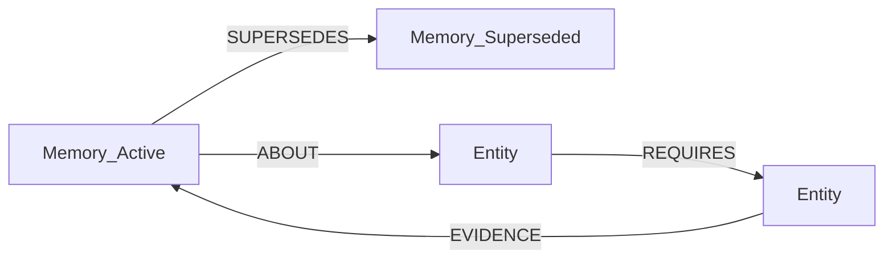
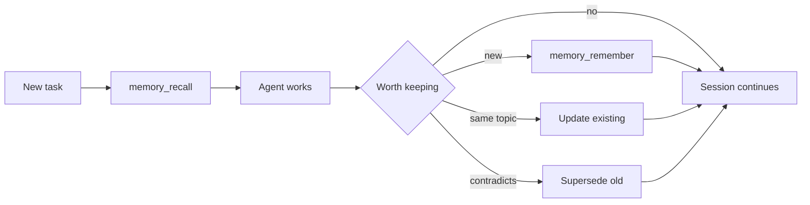

# MCP Memory — product requirements

Production memory service that any MCP coding harness can use to remember and recall durable working context. The agent-facing unit is a Kiro-style statement. The store is one HelixDB knowledge graph, a Rust engine: memory nodes, entity nodes, and the edges between them, with BM25 full-text and vector search on that same graph. Recall is one query that walks the caller's graph, then ranks that set by keyword and vector. A single-user install embeds the engine. The multi-tenant server uses the highly available Helix cluster.

Kiro reference: [Memory](https://kiro.dev/docs/memory/) (title, summary, content, global or one repository, not a transcript). This product matches that agent experience and is stricter where an external server must not trust the model.

## Problem

Coding agents drop corrections, repo commands, conventions, and ruled-out approaches when a session ends. The user repeats them in the next session, and again in a different harness. Steering files and `AGENTS.md` cover rules the user writes on purpose. Memory covers what shows up while working and would otherwise never be written down.

## Users and jobs

- A developer running one or more MCP harnesses (Cursor, Claude Code, Codex, Kiro-as-client, others) against a local or shared server.
- A team that shares repo facts and conventions across machines, with personal preferences kept private.
- Remember a correction, preference, repo fact, convention, or dead end once, and have a later session in any harness use it.
- See, fix, and delete what was stored, including when the agent is not allowed to write.
- Keep one repo's facts out of another repo, and one space's rows out of another space.

## Product shape

Two deployment profiles, one system:

- **Local.** One store process per data directory embeds HelixDB, with the graph on disk. In-memory mode is not this profile, because a stop would drop the graph. Each harness launches a stdio front end that forwards to the store process over a user-only Unix socket and starts it when absent, so several harnesses and the CLI share one writer. One personal space, one principal, created at install. Default access is `learn`.
- **Server.** Same MCP binaries, many principals and spaces, MCP over HTTP. The process refuses to start unless authentication is configured and every query is scoped to the caller's spaces. Helix runs highly available: object storage is the durable store, one writer commits, and readers scale with recall load. MCP replicas are stateless and share that cluster. This profile is Helix Cloud or the enterprise cluster. The open-source single-node server is not the server profile.

Memory content is not sent to an embedding API. The embedding model runs in the MCP process, pinned by id and dimension, and the vector is stored on the memory node. A model change builds a new vector index and backfills it; mixed dimensions in one index are a hard error. If the model fails to load, recall still answers from full-text plus the graph walk, and the result says the vector leg is degraded.

Human control is a CLI and an admin HTTP API with the same operations: show access mode, list, search, show, edit, delete, export, import, reindex, health. CLI and admin delete always work for an authorized principal. Agent delete does not bypass access mode. A GUI is not part of this release.

## Memory record

A memory is one durable statement, not a chat log.

- `id` (opaque, stable), `title`, `summary` (one line), `content`
- `type`: `preference` (how the user wants the agent to work), `fact` (something true about a repo), `convention` (how this repo is built or run), `correction` (a prior agent behavior the user rejected), `ruled_out` (an approach that failed and why)
- `scope`: `global` or `repository`
- `repo_key` when scope is repository (see identity)
- `created_at`, `updated_at` (UTC), `source` (`user` or `automatic`), optional harness name and session id
- `status`: `active`, `superseded`, or `conflicted`; `supersedes` points at the prior id
- `space_id` and `principal_id` on every node. The local profile fills these at install. A query with no space is an error, never a scan across spaces
- content hash, used for conflict detection
- embedding of title + summary + content, derived, stored on the memory node and indexed per space

Bounds: title and summary short; content capped at 20 KiB. Over-cap writes fail with a message to split or shorten. No raw transcripts, no pasted file bodies, no scratch task state ("we are on this branch").

Secret-shaped content (private keys, bearer tokens, cloud credential blobs, `.env` secrets) is rejected. The tool error tells the agent to warn the user and not retry with the same secret.

## Scope and repository identity

Recall for a turn returns only **global** memories plus memories for the **repositories in play**. Never another repo's memories.

Repo key, in order: normalized git remote (`host/path`, lowercase host, strip `.git`), else the canonical realpath of the repo root. Remote-based keys are what a later team sync will use. Path-only keys are local aliases and must not be treated as portable.

Which repo is in play: `project_path` on the tool call, and nothing else. Without it, recall covers global memories only and writes are stored as global. The server cwd says nothing about the agent's repo, and MCP roots are deprecated as of the 2026-07-28 spec (SEP-2577). Each hit is labeled with its scope and repo.

A config override can pin `repo_key` when origin is a fork or missing.

## Access control

Enforced in the server. Prompt text is not the control.

- `off`: recall and list return disabled; writes fail. CLI still reads.
- `read_only`: recall, list, and get work. Agent create, update, and delete fail, including when the user asks in chat. Same as Kiro "Use only".
- `read_write`: agent writes only when the call is marked `explicit` (the user asked to remember, change, or forget). Calls marked `automatic` fail. Same as Kiro "Use but don't learn".
- `learn`: explicit and automatic writes allowed. Same as Kiro "Use and learn".

Untrusted repo: if trust checking is on, that repo is read-only for the agent (global writes included while the active root is untrusted), matching Kiro workspace trust. v1 default is trust-all, because the user started the server. The flag exists so a long-lived daemon can refuse writes from a workspace the user has not trusted.

Sub-agents: the server does not know who the caller is. Contract: a sub-agent client sets access to `read_only` (env or config) for its connection. Parent sessions may write. Document this in the harness snippet; do not pretend the server can detect a sub-agent.

## Agent contract

Compliant clients surface MCP server instructions on each session. Those instructions are part of the product, not an afterthought.

**Recall.** Before non-trivial work, and again when the task moves to a new area (tests, deploy, a subsystem), call `memory_recall` with the user request in the agent's own words. Use what comes back. If the result is empty, proceed; do not invent memories.

**Remember** (`learn` only, `source=automatic`). Write a memory when the user corrects the agent, states a durable preference, or the session discovers a repo fact, command, or dead end that would be expensive to rediscover. Update an existing memory instead of adding a near-duplicate. If new information contradicts an active memory, supersede it; do not leave both active.

**Do not remember** one-off task instructions, anything already in project rules or steering, secrets, or status that will be stale tomorrow.

**Explicit writes** in `read_write` and `learn` when the user says to remember, change, or forget.

Kiro can also extract memories after the session ends, because that step is inside the harness. This server cannot. v1 learning happens in-session. A short "session end" prompt is documented so a harness stop-hook can ask the model to store anything still unwritten. That hook is optional and harness-specific. Correctness of v1 does not depend on it.

Clients that drop server instructions still work if the user installs the shipped rule snippet (`AGENTS.md` or the harness's rules file) with the same recall and remember policy.

Tool results are the only UI the server can guarantee. Every mutating or recall result includes an action (`recalled`, `created`, `updated`, `superseded`, `deleted`, `rejected`) and the titles involved, so a harness can show the Kiro-style "Memory accessed / created / updated" line.

## Tools

Keep the surface small.

- `memory_recall` — query text, optional type filter, optional `project_path`. Returns ranked active hits up to a count and a character budget (defaults: 5 hits, about 8 KB). Each hit: id, title, summary, content, type, scope, repo, score. Below the relevance floor, return no hits.
- `memory_remember` — create, or update when `id` is set, or supersede when `supersedes` is set. Fields: title, summary, content, type, scope, `explicit` vs `automatic`. On a near-duplicate, do not insert; return the existing id and the overlap so the agent updates that record.
- `memory_forget` — one id. No delete-by-query. Blocked for the agent in `read_only` and `off`.
- `memory_list` — filter by scope, repo, type, text; for "what do you remember?", not for task recall.

The agent does not get a pile of graph-editing tools. It writes statements through `memory_remember` and may attach entities and relations on that call. The server commits those edges in the same transaction. `memory_recall` is what searches. `memory_graph` is for inspection and debugging (neighbors of an entity, path between two entities), not the normal learn/recall loop.

Resources (optional for the client): `memory://digest` is titles and summaries only, for global plus repos in play, under a tight cap. Harnesses that inject resources get a cheap index; full content still comes from `memory_recall`. Harnesses that ignore resources lose nothing required.

## Knowledge graph

The graph is the database. Memories are nodes. Entities are nodes. Relationships are edges. Keyword search, vector search, and the walk that ties a question to a related fact all run against this one graph in one transaction. There is no side table of edges and no second database to keep in sync.

Node labels:

- `:Memory:Active` — the statement the agent can recall. Properties: id, title, summary, content, type, scope, repo_key, space_id, principal_id, source, timestamps, content hash, embedding, status `active`.
- `:Memory:Superseded` and `:Memory:Conflicted` — same properties, excluded from recall and from the vector index. A supersede is an edge, not a copied row in another system.
- `:Entity` — canonical name, kind (`service`, `command`, `module`, `library`, `environment`, `other`), aliases, space_id, and either global or a repo_key.
- `:Audit` — append-only action log. Recall queries do not touch this label.

Edge types:

- `(:Memory)-[:ABOUT]->(:Entity)` — this statement is about that entity.
- `(:Entity)-[:REQUIRES|PART_OF|RUNS_WITH|PREFERS|CORRECTS|RULED_OUT_FOR]->(:Entity)` — typed fact between entities. The edge carries the evidence memory id. An edge whose evidence memory is no longer active is not traversed.
- `(:Memory)-[:SUPERSEDES]->(:Memory)` — the new statement replaces the old one.
- `(:Entity)-[:SAME_AS]->(:Entity)` — alias merge, so "local database" and "Postgres" do not fork.

On `memory_remember` the server matches entity names to existing nodes by canonical name and alias, then commits the memory node, the embedding, and the edges in one Helix transaction. The server instructions require entities and relations for `fact`, `convention`, `correction`, and `ruled_out`. A write without them still stores the statement, and health metrics count unlinked writes. A pluggable extractor may add edges later; the write does not wait on a remote model.

Recall is one Helix query:

1. Full-text match on title, summary, and content inside the caller's space.
2. Vector nearest-neighbor on that space's index.
3. Link entities named by the query, walk at most two hops along active edges, and collect the evidence memories.

A query about integration tests can surface the seed-database fact because both share an entity, even when the wording barely overlaps. Candidates are merged and ranked in that same query path. Ranking uses vector similarity, full-text score, a mild boost for the current repo over global, and a mild recency boost. Below the relevance floor, return no hits.

## Indexes and efficiency

One store is the efficiency requirement. A relational database plus a vector server would make every write a distributed transaction and every recall a join across processes. The graph already holds the statement, the links, and the embedding, so those extra systems are not part of this product.

- Vector search is prefiltered. A traversal first limits candidates to the caller's spaces, the repos in play, and active memories. Only that set is ranked. A global top-k that is filtered afterward is not acceptable.
- BM25 full-text on title, summary, and content, prefiltered by the same traversal.
- Lookup indexes on `(space_id, repo_key, id)` and entity `(space_id, repo_key, name)`.
- Uniqueness constraints on memory id and on entity identity inside a space.
- Recall is one Helix request. The hop limit is two. Result size is capped at 5 hits and about 8 KB. On the local profile that request stays inside the store process.
- Writes use one transaction. Supersede marks the old memory superseded in that transaction, and later recalls do not traverse it.

Default embedding model is a pinned, versioned, locally run model with a recorded dimension. English paraphrase recall is an acceptance gate. Other languages are best-effort until a model change and reindex explicitly adopts them. Export omits embeddings; import backfills them onto the nodes.

Near-duplicate consolidation is a background job: it proposes a `SUPERSEDES` edge that keeps both nodes and one surviving statement. It does not drop memories on a decay timer.

## Lifecycle

Superseded nodes stay in the graph for audit and lose the `:Active` label. Human or authorized admin delete removes the memory from recall, writes an `:Audit` tombstone, and drops edges that have no remaining active evidence. Agent forget does the same when access mode allows it.

Process logs must not include memory content or embeddings.

## Configuration

Config covers access mode, trust flag and trusted repo keys, repo-key overrides, recall limits, embedding model id and dimension, the Helix data directory or cluster endpoint, and auth for the server profile. Mode changes apply to the next tool call.

## Tenancy, sync, and conflict

Built in the schema and enforced on every query. The local profile is the one-space case, not a second data model.

- **Principal and space.** Every memory, entity, and relation belongs to a space and a writing principal. Personal spaces hold preferences, corrections, and ruled-out approaches. Team spaces hold `fact` and `convention` for a `repo_key`. Publishing copies a personal fact or convention into a team space; it does not move the personal node. Global personal preferences never auto-join a team space.
- **Isolation.** The caller's credentials resolve to a set of spaces. Every Helix query is bound to that set, and vector and full-text search are prefiltered by a traversal of those spaces. A code path that opens a query without a space binding is a defect. Negative tests must show space A cannot recall, list, or traverse into space B.
- **Identity.** Nodes key by `(space, repo_key or global, id)`. `repo_key` is the normalized git remote. Path aliases stay local to a machine and are not the sync key.
- **Conflict.** Content hashes and `updated_at`. If both sides change content since the same base, the node becomes `conflicted` and is not recalled or traversed until a person resolves it. Tombstones replicate, and a tombstone beats an older edit.
- **Sync payload.** Versioned JSON of memories, entities, relations, and tombstones. Embeddings are omitted and reindexed on import. Import is idempotent on `id`. Sync is opt-in per space. The server profile is the target for team spaces; the transport is the product's own replication of that JSON, with auth, not an ad-hoc file copy.
- **Access.** A team space has its own access mode. `learn` on a personal space does not grant writes on a team space.

## Production bar

These are release gates, not follow-up work.

- Schema migrations are versioned and run expand-then-contract against constraints, indexes, and labels. The running schema version is visible from health.
- Backups follow the Helix store. The local profile restores from its disk volume. The server profile restores from object storage, which is the durable copy. A documented restore plus embedding backfill on a fixture returns the same recall ids.
- Health reports Helix, reader lag behind the writer on the server profile, embedding model id, and schema version.
- Metrics: recall latency, abstain rate, unlinked-write rate, and error rate. No memory content in metrics or logs.
- Scale gate on the reference single-node profile: 1 million active memory nodes across at least 100 spaces, recall p95 under 300 ms excluding cold start, 50 concurrent recalls without error, and 20 writes per second with the graph walk included. Every one of those recalls stays inside the caller's space and repos.
- A killed MCP process mid-write leaves either the whole transaction or none of it. A test cuts the writer during `memory_remember` and asserts there is no active memory missing its edges or embedding from a commit that returned success.

## Non-goals

- Conversation replay, compaction, or ingesting document corpora (PDF, wiki dumps)
- Replacing steering, rules, or `AGENTS.md` (those still win when they conflict; instructions say so)
- A graphical memory browser in this release
- A second database beside the graph, whether relational or vector-only
- Forgetting by time decay
- Cross-space search

## Harness matrix

Must pass the same contract tests over local stdio and over server HTTP against: Cursor, Claude Code, and one other CLI harness. For each: server instructions visible to the model, tools callable, a memory written in harness A recalled in harness B, repo isolation held, space isolation held, `read_only` blocks a write the user asked for in chat.

Ship a one-page snippet for clients that do not inject server instructions. Do not build per-harness plugins in v1.

## Acceptance

- Store a repo fact in harness A. A new session in harness B, paraphrased query, follows it without the user restating it.
- A global preference is recalled in a second repository. A fact from repo A is not.
- A second correction on the same topic updates or supersedes one node; recall returns one statement.
- Unrelated work recalls nothing useful (empty result), not a dump of recent memories.
- `read_only` rejects agent create, update, and delete. CLI delete still removes it.
- `read_write` rejects `automatic` and accepts `explicit`.
- Secret-shaped content is rejected and is absent from the database and logs.
- A fact linked by an entity is recalled from different wording when the query names that entity, including when keyword overlap is weak.
- With the embedding model unloaded, keyword plus graph still hit a titled fact, and the result says the vector leg is degraded.
- A recall that names an entity returns the evidence memory two hops away, and the server trace for that call is a single graph query.
- Cutting the writer during a commit never leaves an `:Active` memory with no embedding and no edges from a response that reported success. Restore from backup plus backfill returns the same ids.
- Space A credentials cannot recall, list, or traverse a memory that exists only in space B.
- The scale gate numbers above are measured and recorded before the release is called production-ready.
- Export, wipe, import, reindex, and recall the same ids.
- Sub-agent config with `read_only` cannot write while the parent config can.

## Status

The local profile is implemented: stdio MCP front end, shared store process, CLI, embedded Helix graph, and tests, including two harness processes and the CLI using one store at once. The embedding model in this build is `token-hash-v1` (384 dimensions), not a semantic model. Health says so. The admin HTTP API, the multi-tenant server profile, and the 1M-memory scale gate are not done. Architecture and the local workflow are in [architecture.md](architecture.md) and [development.md](development.md). Day-to-day use is in [usage.md](usage.md). Harness setup is in [harness-snippet.md](harness-snippet.md).

